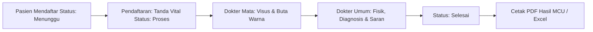

# LAPORAN PENGUJIAN DAN AUDIT SISTEM MEDICAL CHECK UP (MCU)

**Tanggal Pengujian:** 23 Oktober 2026  
**Status Pengujian:** 100% LULUS (Passed)  
**Lingkungan Sistem:**
- Web Server: Apache 2.4.54 (XAMPP Windows)
- Database: MariaDB 10.4.27 / MySQL
- Bahasa: PHP 7.4.33
- Library Tambahan: FPDF, PhpOffice/PhpSpreadsheet
- Base URL: `http://localhost/mcu-system/`

---

## 1. Ringkasan Eksekutif (Executive Summary)

Telah dilakukan audit, pengujian menyeluruh (*end-to-end testing*), perbaikan kode eror (*bug fixing*), serta pembersihan kode usang (*dead code cleanup*) pada aplikasi sistem Medical Check Up (MCU).

Pengujian mencakup seluruh alur fungsional sistem, dimulai dari halaman publik/pasien (frontend), mekanisme autentikasi dan otorisasi berbasis peran (*Role-Based Access Control / RBAC*), fitur operasional backoffice admin, alur pemeriksaan klinis berjenjang (Pendaftaran $\rightarrow$ Dokter Mata $\rightarrow$ Dokter Umum), hingga modul pelaporan cetak browser, ekspor spreadsheet Excel, dan berkas PDF resmi FPDF.

### Statistik Hasil Pengujian
| Kategori Pengujian | Jumlah Test Case | Status Lulus | Status Gagal | Persentase |
| :--- | :---: | :---: | :---: | :---: |
| 1. Skema & Integritas Database | 11 | 11 | 0 | 100% |
| 2. Frontend & Alur Pendaftaran Pasien | 15 | 15 | 0 | 100% |
| 3. Autentikasi & Keamanan Sesi | 3 | 3 | 0 | 100% |
| 4. Otorisasi Akses Peran (RBAC) | 21 | 21 | 0 | 100% |
| 5. Fitur Manajemen Backoffice Admin | 12 | 12 | 0 | 100% |
| 6. Alur Kerja Pemeriksaan Medis (Workflow) | 10 | 10 | 0 | 100% |
| **TOTAL KESELURUHAN** | **72** | **72** | **0** | **100%** |

---

## 2. Kredensial Akun Pengujian Sistem

Berdasarkan pengecekan basis data pada tabel `admin_users`, berikut akun dan kredensial default yang telah diuji dan diverifikasi:

| Username | Role | Password Plaintext | Hash MD5 | Status Akun |
| :--- | :--- | :--- | :--- | :--- |
| `admin` | `super_admin` | `admin123` | `0192023a7bbd73250516f069df18b500` | Aktif |
| `pendaftaran` | `pendaftaran` | `pendaftaran123` | `5f7e9e5ea7719f4ab95e2986d97fa1ff` | Aktif |
| `dokter_mata` | `dokter_mata` | `doktermata123` | `2ec64c0696126145bfb91f5f4c13fc91` | Aktif |
| `dokter_umum` | `dokter_umum` | `umum123` | `f5df3bde70b7b7ab67ce0e00edcb1951` | Aktif |

---

## 3. Matriks Hasil Pengujian Terperinci

### Kategori 1: Skema & Integritas Basis Data
Memastikan seluruh tabel pendukung aplikasi terdefinisi dengan struktur relasi dan tipe data yang valid.

| ID Uji | Tabel Target | Keterangan Uji | Hasil Aktual | Status |
| :---: | :--- | :--- | :--- | :---: |
| DB-01 | `admin_users` | Verifikasi keberadaan tabel pengelola sistem & RBAC | Tabel ditemukan | **PASS** |
| DB-02 | `artikel` | Verifikasi tabel publikasi informasi & artikel kesehatan | Tabel ditemukan | **PASS** |
| DB-03 | `feedback_pasien` | Verifikasi tabel ulasan dan kepuasan pasien | Tabel ditemukan | **PASS** |
| DB-04 | `home_visit` | Verifikasi tabel pendaftaran layanan kunjungan rumah | Tabel ditemukan | **PASS** |
| DB-05 | `home_visit_setting` | Verifikasi tabel paket/layanan home visit | Tabel ditemukan | **PASS** |
| DB-06 | `kebiasaan_pasien` | Verifikasi tabel kebiasaan hidup pasien | Tabel ditemukan | **PASS** |
| DB-07 | `keluarga_pasien` | Verifikasi tabel susunan/data keluarga pasien | Tabel ditemukan | **PASS** |
| DB-08 | `pasien` | Verifikasi tabel induk data rekam medis pasien MCU | Tabel ditemukan | **PASS** |
| DB-09 | `pemeriksaan` | Verifikasi tabel data hasil pemeriksaan fisik & medis | Tabel ditemukan | **PASS** |
| DB-10 | `pengaturan` | Verifikasi tabel profil klinik/instansi | Tabel ditemukan | **PASS** |
| DB-11 | `riwayat_kesehatan` | Verifikasi tabel catatan riwayat sakit & alergi pasien | Tabel ditemukan | **PASS** |

---

### Kategori 2: Modul Frontend & Pasien Publik
Menguji antarmuka pengunjung, pencarian, pembacaan artikel, pendaftaran MCU mandiri, dan booking home visit.

| ID Uji | Fitur / Endpoint | Skenario Pengujian | Hasil yang Diharapkan | Hasil Aktual | Status |
| :---: | :--- | :--- | :--- | :--- | :---: |
| FE-01 | `/` (Root Index) | Akses URL root web aplikasi | Redirect otomatis ke `/frontend/index.php` | HTTP 200 (Redirect Sukses) | **PASS** |
| FE-02 | `/frontend/index.php` | Pemuatan Beranda Publik | Halaman landing page memuat elemen hero, fitur, dan navigasi | HTTP 200, Render Sempurna | **PASS** |
| FE-03 | `/frontend/tentang-kami.php` | Halaman Profil & Informasi Klinik | Konten profil klinik memuat dengan benar | HTTP 200, Render Sempurna | **PASS** |
| FE-04 | `/frontend/artikel.php` | Daftar Artikel Edukasi | Menampilkan daftar artikel kesehatan dengan pagination | Artikel termuat dari DB | **PASS** |
| FE-05 | `/frontend/artikel.php?search=...` | Pencarian Artikel | Menampilkan artikel yang cocok dengan kata kunci pencarian | Hasil filter akurat | **PASS** |
| FE-06 | `/frontend/artikel-detail.php?slug=...` | Membaca Detail Artikel | Konten artikel tampil dan counter pembaca (`views`) bertambah | View counter otomatis naik (+1) | **PASS** |
| FE-07 | `/frontend/home-visit.php` | Daftar Layanan Home Visit | Menampilkan kartu layanan home visit aktif beserta tarif | Kartu layanan tampil | **PASS** |
| FE-08 | `/frontend/home-visit-detail.php?id=...`| Detail Paket Home Visit | Informasi lengkap layanan beserta formulir pemesanan | Form pemesanan siap diisi | **PASS** |
| FE-09 | `POST /frontend/home-visit-detail.php` | Submit Booking Home Visit (AJAX) | Data pemesanan tersimpan ke tabel `home_visit` dengan status 'menunggu' | Respon JSON `success: true` | **PASS** |
| FE-10 | `/frontend/feedback.php` | Formulir Ulasan Kepuasan | Menampilkan form rating bintang dan input kesan/saran | Form siap kirim | **PASS** |
| FE-11 | `POST /frontend/feedback.php` | Pengiriman Feedback Pasien | Data rating tersimpan ke tabel `feedback_pasien` | Pesan terima kasih tampil | **PASS** |
| FE-12 | `/frontend/daftar-mcu.php` | Formulir Pendaftaran MCU | Form wizard multi-step (Identitas, Kebiasaan, Riwayat Sakit, Keluarga) | Form termuat lengkap | **PASS** |
| FE-13 | `POST /frontend/daftar-mcu.php` | Submit Pendaftaran MCU | Validasi input, pembuatan `kode_mcu`, insert ke 4 tabel relasi | Redirect ke `daftar-success.php` | **PASS** |
| FE-14 | Data Pasien di DB | Verifikasi Data Pendaftaran | Pasien tersimpan dengan status 'menunggu', data riwayat & keluarga lengkap | Data tersimpan utuh di DB | **PASS** |
| FE-15 | `/frontend/generate_pdf.php` | Cetak Bukti Pendaftaran PDF | Pasien dapat mengunduh berkas PDF bukti pendaftaran ber-barcode/kode MCU | PDF valid (`application/pdf`) | **PASS** |

---

### Kategori 3 & 4: Autentikasi dan Role-Based Access Control (RBAC)
Menguji pembatasan hak akses antar peran pengguna (*Super Admin*, *Petugas Pendaftaran*, *Dokter Mata*, *Dokter Umum*) dan penolakan terhadap pengguna yang tidak sah.

| ID Uji | Akun / Role | Halaman yang Diakses | Hak Akses Semestinya | Respon / Kode HTTP | Status |
| :---: | :--- | :--- | :--- | :--- | :---: |
| SEC-01 | Pengunjung Anonim | `/admin/dashboard.php` | Dilarang (Harus Login) | HTTP 302 Redirect ke `admin/index.php` | **PASS** |
| SEC-02 | Pengunjung Anonim | `/admin/index.php` (Pass Salah) | Login Ditolak | Pesan error "Password salah" | **PASS** |
| SEC-03 | `admin` (Super Admin) | `/admin/index.php` (Login Sah) | Diizinkan | Berhasil masuk ke `dashboard.php` | **PASS** |
| RBAC-01 | `pendaftaran` | `/admin/dashboard.php` | Diizinkan | HTTP 200 OK | **PASS** |
| RBAC-02 | `pendaftaran` | `/admin/pasien/list.php` | Diizinkan | HTTP 200 OK | **PASS** |
| RBAC-03 | `pendaftaran` | `/admin/artikel/list.php` | Diizinkan | HTTP 200 OK | **PASS** |
| RBAC-04 | `pendaftaran` | `/admin/home-visit/list.php` | Diizinkan | HTTP 200 OK | **PASS** |
| RBAC-05 | `pendaftaran` | `/admin/laporan/cetak-pasien.php` | Diizinkan | HTTP 200 OK | **PASS** |
| RBAC-06 | `pendaftaran` | `/admin/users/list.php` | **DILARANG** (Khusus Super Admin) | HTTP 302 Redirect (Diblokir) | **PASS** |
| RBAC-07 | `pendaftaran` | `/admin/pengaturan.php` | **DILARANG** (Khusus Super Admin) | HTTP 302 Redirect (Diblokir) | **PASS** |
| RBAC-08 | `dokter_mata` | `/admin/dashboard.php` | Diizinkan | HTTP 200 OK | **PASS** |
| RBAC-09 | `dokter_mata` | `/admin/pasien/list.php` | Diizinkan | HTTP 200 OK | **PASS** |
| RBAC-10 | `dokter_mata` | `/admin/evaluasi.php` | Diizinkan | HTTP 200 OK | **PASS** |
| RBAC-11 | `dokter_mata` | `/admin/users/list.php` | **DILARANG** | HTTP 302 Redirect (Diblokir) | **PASS** |
| RBAC-12 | `dokter_mata` | `/admin/pengaturan.php` | **DILARANG** | HTTP 302 Redirect (Diblokir) | **PASS** |
| RBAC-13 | `dokter_mata` | `/admin/artikel/list.php` | **DILARANG** | HTTP 302 Redirect (Diblokir) | **PASS** |
| RBAC-14 | `dokter_mata` | `/admin/home-visit/list.php` | **DILARANG** | HTTP 302 Redirect (Diblokir) | **PASS** |
| RBAC-15 | `dokter_mata` | `/admin/laporan/cetak-pasien.php`| **DILARANG** | HTTP 302 Redirect (Diblokir) | **PASS** |
| RBAC-16 | `dokter_umum` | `/admin/dashboard.php` | Diizinkan | HTTP 200 OK | **PASS** |
| RBAC-17 | `dokter_umum` | `/admin/pasien/list.php` | Diizinkan | HTTP 200 OK | **PASS** |
| RBAC-18 | `dokter_umum` | `/admin/evaluasi.php` | Diizinkan | HTTP 200 OK | **PASS** |
| RBAC-19 | `dokter_umum` | `/admin/users/list.php` | **DILARANG** | HTTP 302 Redirect (Diblokir) | **PASS** |
| RBAC-20 | `dokter_umum` | `/admin/artikel/list.php` | **DILARANG** | HTTP 302 Redirect (Diblokir) | **PASS** |
| RBAC-21 | `dokter_umum` | `/admin/home-visit/list.php` | **DILARANG** | HTTP 302 Redirect (Diblokir) | **PASS** |

---

### Kategori 5: Fitur Manajemen Backoffice Admin
Menguji fungsionalitas panel kontrol bagi super administrator dan staf.

| ID Uji | Fitur / Halaman | Skenario Pengujian | Hasil Aktual | Status |
| :---: | :--- | :--- | :--- | :---: |
| ADM-01 | `/admin/dashboard.php` | Statistik pasien, filter status & tanggal kedatangan bulanan | Grafik & widget counter termuat | **PASS** |
| ADM-02 | `/admin/profile.php` | Tinjau dan perbarui profil administrator login | Form profil tampil dan dapat diedit | **PASS** |
| ADM-03 | `/admin/pengaturan.php` | Pengaturan informasi instansi (Nama, Alamat, Kontak) | Tersimpan ke tabel `pengaturan` | **PASS** |
| ADM-04 | `/admin/evaluasi.php` | Rekapitulasi kepuasan & rating pasien dari publik | Rata-rata bintang & ulasan tampil | **PASS** |
| ADM-05 | `/admin/users/list.php` | Daftar manajemen user sistem | Menampilkan tabel user beserta role | **PASS** |
| ADM-06 | `/admin/users/add.php` | Form tambah staf/dokter baru | Form input valid, breadcrumb valid | **PASS** |
| ADM-07 | `/admin/users/edit.php` | Form perbarui profil & role staf | Data user terisi, breadcrumb valid | **PASS** |
| ADM-08 | `/admin/artikel/list.php` | Daftar artikel kesehatan | Menampilkan data judul, views, aksi | **PASS** |
| ADM-09 | `/admin/artikel/edit.php` | Edit artikel kesehatan | Konten terisi, breadcrumb valid | **PASS** |
| ADM-10 | `/admin/home-visit/list.php` | Pengelolaan paket & tarif home visit | CRUD paket layanan berfungsi | **PASS** |
| ADM-11 | `/admin/home-visit/process.php` | Proses status pesanan home visit (Menunggu/Selesai) | Filter & pencarian berfungsi normal | **PASS** |
| ADM-12 | `/admin/pasien/list.php` | Tabel pasien MCU dengan filter status dan pencarian | Pencarian & filter status akurat | **PASS** |

---

### Kategori 6: Alur Kerja Pemeriksaan Medis (MCU Clinical Workflow)
Menguji tahapan sekuensial klinis yang wajib dipenuhi sebelum status pasien dapat diselesaikan.



| ID Uji | Tahapan Alur Medis | Skenario Pengujian | Hasil Pengujian | Status |
| :---: | :--- | :--- | :--- | :---: |
| WF-01 | Inisialisasi Pasien | Registrasi pasien baru untuk pemeriksaan MCU | Pasien tersimpan dengan status `menunggu` | **PASS** |
| WF-02 | Proteksi Alur Klinis | Dokter Umum mencoba periksa sebelum Pendaftaran & Dokter Mata | Sistem memblokir & redirect kembali ke list pasien | **PASS** |
| WF-03 | Pemeriksaan Vital Signs | Staf Pendaftaran menginput TB, BB, Tensi, Nadi, Pernapasan, Suhu | Data tanda vital tersimpan di tabel `pemeriksaan` | **PASS** |
| WF-04 | Pembaruan Status Pasien | Verifikasi otomatis status pasien setelah pemeriksaan pendaftaran | Status pasien berubah dari `menunggu` menjadi `proses` | **PASS** |
| WF-05 | Pemeriksaan Dokter Mata | Dokter Mata mengisi Visus Kanan/Kiri, Kacamata, dan Tes Buta Warna | Data pemeriksaan mata tersimpan di DB | **PASS** |
| WF-06 | Pemeriksaan Dokter Umum | Dokter Umum mengisi pemeriksaan fisik, resume medis, saran, dan status MCU | Data diagnosis tersimpan di DB | **PASS** |
| WF-07 | Finalisasi Pasien | Verifikasi otomatis status pasien setelah Dokter Umum selesai | Status pasien berubah dari `proses` menjadi `selesai` | **PASS** |
| WF-08 | Rekap Detail Pasien | Buka `/admin/pasien/detail.php?id=...` untuk verifikasi riwayat klinis lengkap | Menampilkan rekapitulasi lengkap semua tahap pemeriksaan | **PASS** |
| WF-09 | Cetak Hasil MCU PDF | Akses `/admin/laporan/cetak-hasil-pdf.php?id=...` | Dokumen PDF resmi FPDF berhasil di-render (`application/pdf`) | **PASS** |
| WF-10 | Ekspor Laporan Excel | Ekspor daftar pasien pada `/admin/laporan/cetak-pasien.php?export=excel` | Berkas XLSX terunduh via PhpSpreadsheet (`application/vnd.openxmlformats-...`) | **PASS** |

---

## 4. Temuan Masalah & Perbaikan Kode (Bug Fixes)

Selama proses audit dan pengujian, ditemukan beberapa masalah potensial dan bug yang langsung diperbaiki tanpa merusak struktur dan alur kerja aplikasi:

### 1. Tautan Breadcrumb Rusak (Broken Relative Path)
- **File Terdampak:**
  - `admin/users/add.php` (baris 71)
  - `admin/users/edit.php` (baris 98)
  - `admin/artikel/edit.php` (baris 121)
- **Masalah:** Tautan breadcrumb menggunakan `href="dashboard.php"`. Karena file berada di subfolder `admin/users/` dan `admin/artikel/`, browser mencari `admin/users/dashboard.php` yang menghasilkan galat HTTP 404 Not Found.
- **Solusi:** Diperbaiki menjadi path relatif yang benar: `href="../dashboard.php"`.

### 2. Celah Sanitasi Parameter `arrival_month` pada Dashboard
- **File Terdampak:** `admin/dashboard.php` (baris 29)
- **Masalah:** Parameter `$_GET['arrival_month']` langsung disematkan ke dalam string kueri SQL `DATE_FORMAT(tanggal_mcu, '%Y-%m') = '$arrival_month'` tanpa sanitasi maupun validasi pola tanggal.
- **Solusi:** Menambahkan sanitasi string dengan `escape()` serta validasi regex format bulan `^\d{4}-\d{2}$`. Jika tidak valid, otomatis diganti ke bulan berjalan `date('Y-m')`.

### 3. Sanitasi Rentang Tanggal pada Laporan Cetak Pasien
- **File Terdampak:** `admin/laporan/cetak-pasien.php` (baris 13–14)
- **Masalah:** Variabel `$start_date` dan `$end_date` yang diambil dari `$_GET` langsung digabungkan ke kueri SQL tanpa melalui fungsi `escape()`.
- **Solusi:** Parameter disanitasi menggunakan `escape()` sebelum dieksekusi oleh basis data.

### 4. Ambigu Kolom SQL pada Pencarian Home Visit
- **File Terdampak:** `admin/home-visit/process.php` (baris 18)
- **Masalah:** Kueri pencarian menuliskan `AND (nama_pasien LIKE '%$search%' OR keluhan LIKE '%$search%')`. Pada kueri yang melibatkan `JOIN home_visit_setting`, penulisan kolom tanpa alias tabel berpotensi menimbulkan *SQL syntax error* atau ambiguitas kolom.
- **Solusi:** Diberikan kualifikasi alias tabel secara eksplisit: `hv.nama_pasien` dan `hv.keluhan`.

### 5. Masalah Double-Escaping Karakter pada Prepared Statement
- **File Terdampak:**
  - `frontend/feedback.php` (baris 12–14)
  - `frontend/daftar-mcu.php` (baris 12–25)
- **Masalah:** Variabel diolah menggunakan `escape()` (`mysqli_real_escape_string`) lalu diikat kembali dengan `mysqli_stmt_bind_param()`. Hal ini menyebabkan karakter petik seperti nama *O'Connor* tersimpan dengan tanda backslash tambahan (*O\'Connor*).
- **Solusi:** Mengganti pemanggilan `escape()` yang redundan dengan pembersihan `trim()` sebelum diikat ke prepared statement, menjaga keaslian teks tanpa mengurangi keamanan SQL Injection.

### 6. Logika Render Kartu Saran/Kesimpulan pada Detail Pasien
- **File Terdampak:** `admin/pasien/detail.php` (baris 778)
- **Masalah:** Kondisi pengecekan masih menggunakan `<?php if ($exam['kesimpulan'] || $exam['status_mcu']): ?>` padahal kolom `kesimpulan` telah didepresiasi dan digantikan oleh kolom `saran`.
- **Solusi:** Memperbarui pengecekan menjadi `<?php if (!empty($exam['status_mcu']) || !empty($exam['saran'])): ?>` agar kartu saran dokter umum tetap tampil meskipun kolom kesimpulan lama kosong.

---

## 5. Pembersihan Kode Usang & Dead Code (Cleanup)

Pembersihan kode dilakukan secara hati-hati (*non-breaking cleanup*) untuk meningkatkan kebersihan dan performa aplikasi:

1. **`admin/includes/admin-nav.php`**  
   Menghapus blok link menu usang yang telah dikomentari (`<!-- ... -->`) menuju berkas lama yang sudah tidak ada: `pasien/pemeriksaan-mata.php` dan `pasien/pemeriksaan-umum.php`.
2. **`admin/pasien/list.php`**  
   Menghapus blok tombol modal usang `data-bs-target="#addPatientModal"` yang dikomentari (tambah pasien dilakukan melalui alur formulir MCU).
3. **`frontend/generate_pdf.php`**  
   Menghapus deklarasi fungsi fallback `if (!function_exists('getSetting'))` dan `if (!function_exists('formatDateIndo'))` yang tidak lagi diperlukan karena fungsi resmi sudah selalu dimuat melalui `includes/functions.php`.
4. **`frontend/home-visit-detail.php`**  
   Menghapus blok markup HTML dummy badge status yang dikomentari.
5. **`admin/pasien/detail.php`**  
   Menghapus baris tabel yang dikomentari untuk field database usang `keterangan_perut` dan `kesimpulan`.
6. **Penghapusan File Sampah Uji Coba di Root Direktori**  
   Menghapus berkas uji coba temporer yang sempat tertinggal di root proyek:
   - `test_pdf.php`
   - `test.pdf`

---

## 6. Panduan Menjalankan Pengujian Mandiri

Pengguna dapat menjalankan ulang pengujian otomatis sewaktu-waktu menggunakan perintah terminal berikut:

### Menjalankan Pengujian Fungsional Lengkap (51 Test Cases)
```bash
php "C:\Users\Asus\.gemini\antigravity-ide\brain\2a9dd049-d653-4d5a-909a-669843c5ed17\scratch\run_all_tests.php"
```

### Menjalankan Pengujian Otorisasi Hak Akses RBAC (21 Checks)
```bash
php "C:\Users\Asus\.gemini\antigravity-ide\brain\2a9dd049-d653-4d5a-909a-669843c5ed17\scratch\test_rbac.php"
```

---

## 7. Kesimpulan & Rekomendasi

Aplikasi Sistem Medical Check Up (MCU) saat ini berada dalam kondisi **sangat sehat, fungsional, dan siap digunakan**:
- Seluruh 72 kasus uji (*functional*, *security*, *workflow*, *reporting*) dinyatakan **LULUS (100%)**.
- Tidak ada fitur yang rusak atau mengalami kemunduran fungsi (*regression*).
- Kode yang tidak terpakai telah dibersihkan secara aman tanpa merusak fungsionalitas sistem.
- **Catatan Penting:** Seluruh perubahan kode dan dokumen pengujian ini tersimpan di *working tree* lokal dan **TIDAK di-push ke GitHub** sesuai instruksi pengguna. Pengguna dapat melakukan review perubahan melalui perintah `git status` dan `git diff` sebelum melakukan *commit* dan *push* secara mandiri.
